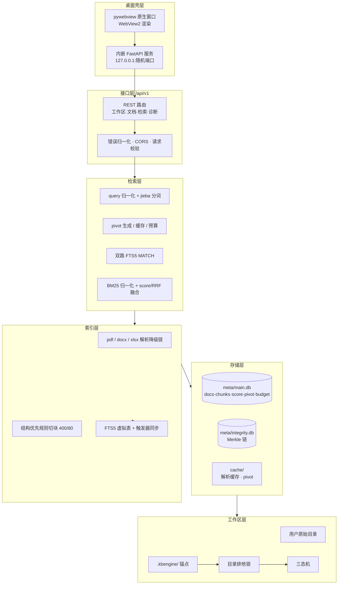

# 盘枢 · Panhub KBEngine

> 目录即工作区，索引是目录的可再生副产物。
>
> 一个纯本地、可离线、可审计、可整体搬走的 Windows 端目录级 RAG 中台。

盘枢不是一个「把文件上传到服务器再检索」的套壳工具，而是把 RAG 能力绑定到用户已有的目录结构上。指定 `D:\项目资料\` 为工作区后，盘枢在该目录下创建隐藏的 `.kbengine/` 信任锚点，写入自描述配置、切片、FTS5 索引、融合分数、Merkle 完整性链与运行时锁。整个目录可以复制、迁移、放 NAS、挂到另一台机器，行为不变。

- **零云端依赖**：原始文档与切片正文默认不出机；联网只发生在用户显式配置的 LLM 端点。
- **零 GPU 依赖**：不下载 embedding 模型，检索由 SQLite FTS5 原生 BM25 承担。
- **可自证完整**：Merkle 哈希链 + AES-256-GCM 状态封装，篡改可定位到首个坏记录。
- **单文件交付**：`Panhub.exe` 双击启动本地原生窗口（WebView2），无需安装 Python。

---

## 目录

- [核心特性](#核心特性)
- [架构总览](#架构总览)
- [六层架构详解](#六层架构详解)
- [工作区与目录契约](#工作区与目录契约)
- [数据模型](#数据模型)
- [检索链路](#检索链路)
- [完整性保护](#完整性保护)
- [三态机与降级策略](#三态机与降级策略)
- [接口设计](#接口设计)
- [MCP：本地 Agent 接入](#mcp本地-agent-接入)
- [快速开始](#快速开始)
- [打包为单文件 exe](#打包为单文件-exe)
- [测试](#测试)
- [设计取舍](#设计取舍)
- [性能与容量](#性能与容量)
- [当前实现范围与路线图](#当前实现范围与路线图)

---

## 核心特性

| 能力 | 实现 |
|---|---|
| 目录即工作区 | `.kbengine/` 隐藏目录作为唯一信任锚点，元数据/索引/链/锁全部自包含 |
| 中文全文检索 | jieba `cut_for_search` 空格分词入库 + SQLite FTS5 倒排 + BM25 列权重 |
| 双路召回 | 原始 query 一路 + LLM 生成的「连接词」第二路，各自独立 MATCH |
| 融合排序 | `retrieval_score` 表 `WITHOUT ROWID` + `STORED` 计算列 + B+Tree 排序 |
| 成本可控 | pivot 按 query hash 全量缓存；daily/monthly/total 预算桶；超限自动降级 |
| 完整性 | SHA-256 Merkle 链（独立库）+ HKDF 派生密钥 + AES-256-GCM 状态封装 |
| 三态运行 | Normal / Detached / Tampered，只读降级、写路径拦截、前端徽标提示 |
| 多级解析降级 | PDF 三级、DOCX 两级、XLSX 结构表化，失败不中断批量任务 |
| 跨进程锁 | Windows `msvcrt.locking(LK_NBLCK)` 非阻塞排他 + PID 僵尸锁检测 |
| 桌面交付 | pywebview + Edge WebView2 原生窗口，后端随机 loopback 端口内嵌启动 |
| Agent 接入 | MCP 服务（Streamable HTTP 端口 + stdio），10 个检索/索引/完整性工具 |

---

## 架构总览



**链路时序**：用户输入 query → 归一化 → 查 `pivot_cache`（命中则跳过 LLM）→ 生成连接词 → 两路 FTS5 MATCH 得两套 `(chunk_id, score)` → 写入 `retrieval_score`（含 `STORED fused` 列）→ 按 `fused` 排序取 topk → 回读 chunk 正文与来源 → 返回。

整条链路唯一可能的外部依赖是 LLM，失败即降级为单路 BM25；数据库与文件系统是本地强依赖。

---

## 六层架构详解

### 1. 桌面壳层（`app/desktop.py`）

- FastAPI 以 uvicorn 线程方式内嵌，绑定 `127.0.0.1` 的**随机空闲端口**，不暴露 0.0.0.0。
- `pywebview` 调用系统 Edge WebView2 打开原生窗口，无浏览器地址栏。
- 关闭窗口时：`server.should_exit = True` → 关闭所有工作区连接 → `wal_checkpoint(TRUNCATE)` → 释放目录锁。
- 崩溃写 `%LOCALAPPDATA%\Panhub\logs\desktop.log`；缺 WebView2 运行时弹窗提示。

同时保留无界面形态：`Panhub.exe server --port 7869`，复用同一套 API 与 schema。

### 2. 接口层（`app/api/`）

- 统一前缀 `/api/v1`，错误体 `{"error": {"code", "message", "details"}}`。
- 错误码映射到 HTTP：`workspace.locked(409)`、`workspace.anchor_mismatch(409)`、`workspace.tampered(403)`、`fts5.unavailable(503)`、`llm.budget_exceeded(429)` 等。
- 请求限制：query ≤ 512 字符、topk ≤ 100；索引任务同步返回统计与失败清单。
- 中间件兜底未捕获异常，绝不把 SQL 错误直接抛给前端。

### 3. 检索层（`app/retrieval/`）

- **归一化**：NFC → 全半角统一 → 英文小写 → 空白合并 → 长度上限 512 → 去停用词。
- **分词一致**：入库与查询两侧都走 jieba `cut_for_search`，query token 以 OR 拼成 FTS5 MATCH（短语双引号转义，防注入）。
- **pivot**：LLM 只产出 3–8 个连接词/关系词，JSON 严格解析；缓存键 `SHA-256(q_norm|model|prompt_version|workspace_id)`，命中即零成本。
- **双路召回**：两条独立 SQL，各自取 `rerank_topk` 候选。
- **归一化**：BM25 越小越相关，按 Min-Max 映射；最大值等于最小值时全置 1。
- **融合**：默认 `score`（`fused = α·norm_original + (1-α)·norm_pivot`），备选 RRF（`Σ 1/(k+rank)`）。
- **排序**：融合结果写入 `retrieval_score`，应用层仅 `ORDER BY fused DESC LIMIT k`，不拉全表。

### 4. 索引层（`app/ingest/` + `app/index/`）

- **解析降级链**：
  - PDF：`pypdf` → `pdfplumber` → `pymupdf(fitz)`
  - DOCX：`python-docx`（保留标题层级与表格）→ `docx2txt`
  - XLSX：`openpyxl` 逐 sheet 转「表头 + 行文本」，单元格以 `|` 连接
  - 纯文本：UTF-8 → GB18030 → UTF-16 依次尝试
- **切块**：结构边界（标题/分页/表格/段落）优先；表格不切断；目标 400 token、重叠 80 token；token 以 jieba 词数×1.3 + 字符数×0.4 估算。
- **增量**：`(workspace_id, rel_path, content_sha256)` 唯一约束识别新增/变更；重建切片先清后写，事务提交。
- **FTS 同步**：`chunks` 表上的 AFTER INSERT/DELETE/UPDATE 触发器维护 `chunks_fts`，保证索引与正文永不脱节。

### 5. 存储层（`app/storage/`）

- 每个工作区独立 `main.db`（业务）与 `integrity.db`（链），互不阻塞。
- PRAGMA 基线：`WAL`、`synchronous=NORMAL`、`foreign_keys=ON`、`busy_timeout=5000`、`cache_size=-65536`、`mmap_size=256MB`、`temp_store=MEMORY`。
- 版本化迁移：`migrations/NNN_*.sql` 顺序执行并记录 `schema_migrations`，可重入。
- 关闭/退出时 `wal_checkpoint(TRUNCATE)`；禁止在程序外删除 `-wal`。

### 6. 工作区层（`app/workspace/`）

- **锚点**：`anchor.sha256 = SHA-256(root_path_norm | created_at | salt)`，绑定目录身份；迁移后需显式重映射，不静默接管。
- **锁**：`.kbengine/lock/workspace.lock` 上 `msvcrt.LK_NBLCK`；`lock.json` 记录 PID/启动时间，僵尸锁可检测。
- **三态机**：状态落 `workspace_state` 表，前端徽标实时显示 `在线 / 已分离 / 完整性异常`。
- **注册表**：单进程 `dict[workspace_id, Workspace]`，每工作区独立连接、锁与状态；跨工作区请求一律拒绝。

---

## 工作区与目录契约

```
D:\workspace\                          # 用户可见的原始文档
├─ 合同\2026-交付合同.pdf
├─ 会议纪要.docx
├─ 预算表.xlsx
└─ .kbengine\                          # 隐藏目录，信任锚点
   ├─ anchor.sha256                    # 根路径 + 创建时间 + salt 的哈希
   ├─ workspace.toml                   # 自描述配置
   ├─ lock\                            # 跨进程排他锁
   ├─ meta\
   │  ├─ main.db                       # docs/chunks/score/pivot/budget
   │  └─ integrity.db                  # 独立 Merkle 链库
   ├─ cache\                           # 解析缓存 / pivot
   ├─ tmp\  export\  logs\
   └─ index\                           # 预留独立索引位置
```

**备份最小单元 = 原始文档目录 + `.kbengine/` 整体。** 严禁只备份 `.kbengine/` 后声称可恢复；复制时禁止丢弃 `-wal`/`-shm`。

`workspace.toml` 关键字段（缺失按默认补齐，未知字段告警）：

```toml
schema_version = 1
workspace_id = "kb-<uuid>"
root_path = "D:\\workspace"

[retrieval]
default_topk = 20
rerank_topk = 50
alpha = 0.5
fusion = "score"          # score / rrf
bm25_title_weight = 3.0
bm25_body_weight = 1.0

[llm]
enabled = true
endpoint = "https://api.openai.com/v1"
api_key_ref = "keyring://kbengine/llm"   # 明文密钥禁止落库
model = "gpt-4o-mini"
budget_monthly_usd = 1.0
timeout_ms = 8000

[integrity]
mode = "chain"
chain_scope = "all"
```

---

## 数据模型

| 表 | 作用 | 关键设计 |
|---|---|---|
| `docs` | 文档登记 | `UNIQUE(workspace_id, rel_path, content_sha256)` 支撑增量去重 |
| `chunks` | 检索最小单元 | 标题/正文/分词正文/页码/哈希；`(doc_id, seq)` 上下文回填 |
| `chunks_fts` | FTS5 虚拟表 | `unicode61` 分词器；触发器与 `chunks` 强一致 |
| `retrieval_score` | 双路分数落表 | `WITHOUT ROWID` 聚簇主键；`fused` 为 `STORED` 生成列 |
| `pivot_cache` | 连接词缓存 | 主键为 query hash，命中不扣预算 |
| `llm_budget` | 预算桶 | daily / monthly / total，乐观扣减 |
| `integrity_chain` | Merkle 链 | `prev_hash` 串联 + GCM 封包状态 |
| `config_kv` | 运行时参数 | 与 `workspace.toml` 冲突时以 toml 为准 |
| `workspace_state` | 三态 | normal / detached / tampered + 原因 |

融合表的物理设计是「把排序交给 B+Tree」这一决策的落点：

```sql
CREATE TABLE retrieval_score (
  query_run_id TEXT NOT NULL,
  chunk_id     INTEGER NOT NULL,
  route        TEXT NOT NULL,        -- original / pivot / fused
  rank         INTEGER NOT NULL,
  raw_score    REAL NOT NULL,
  norm_score   REAL NOT NULL DEFAULT 0,
  fused        REAL GENERATED ALWAYS AS (
      CASE route WHEN 'fused' THEN norm_score ELSE 0 END
  ) STORED,
  PRIMARY KEY (query_run_id, route, chunk_id)
) WITHOUT ROWID;

CREATE INDEX idx_score_fused ON retrieval_score(query_run_id, fused DESC);
```

---

## 检索链路

```
query
  │  归一化：NFC / 全半角 / 小写 / 去停用词
  ▼
pivot_cache ──命中──► pivots（零成本）
  │ 未命中
  ▼
LLM（可选）──失败/超预算──► 单路降级
  │
  ├──────────────┐
  ▼              ▼
原始路 MATCH    连接词路 MATCH
  │              │
  └── BM25 归一化 ──┘
          │
          ▼
  score / RRF 融合 → retrieval_score(fused)
          │
          ▼
  ORDER BY fused DESC LIMIT topk → 回读正文 → 返回
```

**降级顺序**：端点不可达 → 超时 → HTTP 非 2xx → JSON 解析失败 → 置信度过低 → 预算不足 → 全部回退单路原始 BM25。降级后检索结果仍完整可用，调试面板显示 `degraded=true` 与原因，不弹错误。

---

## 完整性保护

每条链记录：

```
payload_hash = SHA-256(scope | scope_key | prev_hash | canonical(state_json))
state_key    = HKDF(master_key, salt, workspace_id | scope)
state_b64    = AES-256-GCM(state_key, nonce, canonical(state_json))
```

- 链库独立于业务库，校验与查询互不阻塞。
- 校验从 `seq=1` 逐条重算 `payload_hash`、验证 GCM tag、检查 `prev_hash` 连续性；失败定位首个坏 `seq` 与 `scope`。
- 校验失败 → 状态切换 `tampered`：只读浏览可用，写索引与导出被禁用。
- 记录覆盖范围：`docs`（扫描/删除）、`chunks`（索引批次）、`meta`（pivot 等）。

**威胁模型**：防的是「数据被静默篡改而无人发现」——本地数据库被改、索引被回滚、配置被替换、`-wal` 被截断、备份被部分覆盖。不防管理员权限替换锚点/密钥、物理拆盘、以当前用户身份直接调用 API。

---

## 三态机与降级策略

| 状态 | 进入条件 | 能力 | 前端徽标 |
|---|---|---|---|
| Normal | 锚点一致、链校验通过、盘可达 | 全功能 | 绿色「在线」 |
| Detached | NAS/网络盘不可达或只读 | 只读检索，禁止写索引 | 黄色「已分离」 |
| Tampered | 链校验失败或锚点不一致 | 只读浏览，禁止导出与写 | 红色「完整性异常」 |

写路径（扫描/索引/删除）在非 Normal 状态下由 API 层直接拦截并返回明确错误码。

---

## 接口设计

| Method / Path | 说明 |
|---|---|
| `GET /api/v1/healthz` | 存活探针 |
| `GET /api/v1/readyz` | 就绪探针 + 工作区状态 |
| `GET /api/v1/workspaces` | 已打开工作区列表 |
| `POST /api/v1/workspaces/init` | 初始化目录为工作区 |
| `POST /api/v1/workspaces/open` | 打开（锚点校验 + 加锁） |
| `POST /api/v1/workspaces/{id}/close` | 释放锁与连接 |
| `GET /api/v1/workspaces/{id}` | 配置、状态、统计 |
| `POST /api/v1/workspaces/{id}/verify` | Merkle 链校验 |
| `POST /api/v1/workspaces/{id}/documents/scan` | 增量扫描 |
| `POST /api/v1/workspaces/{id}/documents/index` | 解析 + 切块 + 建索引 |
| `GET /api/v1/workspaces/{id}/documents` | 文档列表 |
| `DELETE /api/v1/workspaces/{id}/documents/{doc_id}` | 删除文档与切片 |
| `POST /api/v1/workspaces/{id}/retrieval` | 双路检索 + 融合 |
| `GET /api/v1/workspaces/{id}/budget` | LLM 预算快照 |
| `GET /api/v1/workspaces/{id}/chain` | 链头信息 |
| `POST /api/v1/llm/test` | LLM 连通性测试 |

---

## MCP：本地 Agent 接入

盘枢内置一个 **MCP（Model Context Protocol）服务端**，让 Claude Desktop、Cursor、自研 Agent 直接调用本地知识库。进程内共享同一个工作区注册表与检索引擎，无需额外部署。

### 两种接入形态

| 形态 | 端点 / 命令 | 适用 |
|---|---|---|
| Streamable HTTP | `http://127.0.0.1:7868/mcp`（默认端口，占用时自动顺延） | 支持 HTTP 传输的 Agent、远程本机调用 |
| stdio | `Panhub.exe mcp` | Claude Desktop、Cursor 等以子进程启动的客户端 |

- 端口仅绑定 `127.0.0.1`，不对外网开放；可用 `--mcp-port 0` 关闭 HTTP 端口。
- 传输为**无状态 + JSON 响应**模式：Agent 无需维护会话，进程退出不等待空闲会话。
- 启动日志会打印 `MCP LISTENING port=7868`；UI「设置」页也会显示当前端点与工具清单。

### 工具清单

| 工具 | 说明 |
|---|---|
| `list_workspaces` | 列出已打开工作区及状态/统计 |
| `open_workspace` | 打开本地目录作为工作区（锚点校验 + 加锁） |
| `workspace_status` | 查询三态、原因、文档/切片统计 |
| `list_documents` | 文档列表（≤500 条，含索引状态） |
| `scan_documents` | 增量扫描目录 |
| `index_documents` | 解析 + 切块 + 建 FTS5 索引（可指定 doc_ids） |
| `search` | 双路 BM25 检索（query/topk/use_pivot），返回片段、来源、融合分数 |
| `verify_integrity` | Merkle 链校验，失败返回首个坏 seq/scope |
| `get_budget` | LLM 预算使用情况 |
| `delete_document` | 删除文档及切片（仅 Normal 状态） |

### 客户端配置示例

Claude Desktop（`claude_desktop_config.json`，stdio）：

```json
{
  "mcpServers": {
    "panhub": {
      "command": "E:\\path\\to\\Panhub.exe",
      "args": ["mcp"]
    }
  }
}
```

HTTP 客户端（JSON 配置示意）：

```json
{
  "mcpServers": {
    "panhub": {
      "url": "http://127.0.0.1:7868/mcp"
    }
  }
}
```

### 安全边界

- MCP 与 UI 共用同一进程、同一工作区锁；工作区未打开时需先 `open_workspace`。
- 写类工具（`scan/index/delete`）在 Detached / Tampered 状态下会被拒绝。
- HTTP 传输启用 Host 校验（仅允许 `127.0.0.1:*` / `localhost:*`），抵御 DNS rebinding。
- 与 UI 并发写入同一工作区时，通过工作区级写锁串行化，不会打破索引一致性。

---

## 快速开始

### 直接使用（单文件 exe）

```powershell
dist\Panhub.exe
```

双击即启动本地原生窗口；关闭窗口自动优雅退出并释放锁。

### 开发模式

```powershell
uv sync
uv run python -m app desktop                # 本地窗口（默认，MCP 端口 7868）
uv run python -m app server --port 7869     # 无界面后端
uv run python -m app mcp                    # stdio MCP 服务（供 Agent 拉起）

cd frontend
npm install
npm run dev                                 # http://127.0.0.1:5180，代理 /api
```

### 使用流程

1. 「初始化新工作区」→ 输入目录路径（如 `D:\项目资料`）。
2. 「文档」页 → 扫描目录并建索引（pdf / docx / xlsx / txt / md）。
3. 「检索」页输入中文 query；可开启 LLM 连接词第二路（「设置」中配置 OpenAI 协议端点）。
4. 「完整性」页校验 Merkle 链；篡改任意链记录即进入 Tampered 只读态。

---

## 打包为单文件 exe

```powershell
cd frontend
npm run build                                # 产物 frontend/dist
cd ..
uv run pyinstaller pyinstaller.spec --noconfirm --clean
# dist\Panhub.exe：单文件，内嵌前端、迁移 SQL、WebView2 资源
```

- 单文件启动时解压到临时目录，首次启动约 3–8 秒（待实测）。
- 运行需要 Microsoft Edge WebView2 Runtime（Win10 1909+/Win11 通常自带）。
- GUI 模式无控制台，运行日志写入 `%LOCALAPPDATA%\Panhub\logs\console.log`，
  崩溃堆栈写入同目录 `desktop.log`。
- PyInstaller 不支持交叉编译，必须在 Windows 目标机打包。

---

## 测试

```powershell
uv run python -m pytest tests/test_core.py -v
```

当前覆盖：

- 工作区初始化 / 打开 / 锚点校验与不匹配检测
- 跨进程锁互斥（msvcrt）
- 扫描 + 索引 + 中文检索端到端
- Merkle 链校验与篡改检测
- query 归一化与 FTS5 MATCH 构造
- MCP 工具端到端（打开/索引/检索/校验）与 HTTP 握手（initialize）

前端构建产物与打包 exe 均做过实际冒烟：初始化 → 扫描 → 索引 → 检索命中 → 链校验通过。

---

## 设计取舍

| 决策 | 放弃的 | 换来的 |
|---|---|---|
| 目录优先于数据库 | 单一权威存储、文件副本去重 | 可移动、NAS/同步盘兼容、用户信任 |
| BM25 双路而非向量召回 | 语义上限 | 零 GPU、零模型下载、确定性延迟 |
| 连接词是查询改写 | 图谱三元组与多跳扩散 | 预算可控、输出可收敛、可解释 |
| 排序交给 B+Tree | Python 层归并 | `WITHOUT ROWID` 聚簇 + `STORED` 索引直出 |
| 链不进热路径 | 实时完整性证明 | 读路径零哈希开销 |
| 单进程多工作区 | 多进程隔离 | 省资源、无端口冲突；LAN 多用户需多实例 |
| 明文密钥禁止落库 | 配置便利 | 密钥进 keyring，泄露面收敛 |

---

## 性能与容量

以下为工程估算，**待真实中文语料基准测试校正**。硬件前提：NVMe SSD、16GB 内存、4 核 CPU、无 GPU。

| 分级 | chunk 数 | 检索 P95 目标 | 存储 | 适用 |
|---|---:|---:|---:|---|
| 舒适区 | ≤ 5 万 | ≤ 200ms（待验证） | ≤ 4GB | 默认体验 |
| 可跑区 | ≤ 20 万 | ≤ 800ms（待验证） | ≤ 16GB | 中等项目库 |
| 硬上限 | ≤ 50 万 | ≤ 2s（待验证） | ≤ 40GB | 设计上限，超则拆分工作区 |

慢查询控制：每路只取 `rerank_topk`；归一化与 jieba 词典启动期一次加载；批量写入走事务；FTS5 用 `bm25()` 排序避免全表扫。

---

## 当前实现范围与路线图

**已实现**

- 工作区初始化 / 打开 / 关闭、锚点校验、msvcrt 排他锁
- PDF/DOCX/XLSX/TXT 解析降级、jieba 切块、增量扫描与索引
- 双路 BM25 检索、score/RRF 融合、`retrieval_score` 落表排序
- pivot 缓存、LLM OpenAI 协议适配、预算桶与自动降级
- Merkle 链 + AES-256-GCM、篡改检测、Tampered 只读拦截
- 浅色「宣纸」中台 UI、单文件 exe 桌面窗口
- MCP 服务端（Streamable HTTP 7868 + stdio），10 个 Agent 工具

**规划中**

- Detached 态的 NAS 心跳探测与自动切换
- 迁移重映射（`/remap`）与密钥轮换工具
- 异步索引任务 + WebSocket 进度推送
- 备份/恢复向导、诊断包导出
- 中文语料基准测试与 SLA 回填

---

## 目录结构

```
panhub-kbengine/
├─ app/
│  ├─ __main__.py        # 入口：desktop（默认）/ server
│  ├─ desktop.py         # pywebview 窗口 + 内嵌 uvicorn
│  ├─ main.py            # FastAPI create_app + 静态托管
│  ├─ config.py          # workspace.toml 解析与校验
│  ├─ api/               # 路由 + 错误归一化
│  ├─ workspace/         # 锚点 / 锁 / 三态 / 注册表
│  ├─ ingest/            # 解析降级链 + 切块
│  ├─ index/             # 扫描 / 索引 / 删除
│  ├─ retrieval/         # 归一化 / 双路 / 融合
│  ├─ integrity/         # Merkle 链 + GCM
│  ├─ llm/               # Provider + 预算
│  ├─ mcp/               # MCP 服务端（工具 + HTTP/stdio 传输）
│  ├─ storage/           # SQLite 连接与迁移
│  └─ security/          # 预留
├─ frontend/             # React + Vite（宣纸主题）
├─ migrations/           # 版本化 SQL
├─ tests/                # 核心链路测试
├─ pyinstaller.spec      # 单文件 exe 打包
├─ pyproject.toml        # uv 依赖与工具配置
└─ uv.lock
```

---

*方案基线：SQLite ≥ 3.37.2（FTS5 / STORED / WITHOUT ROWID）、Python 3.11+、uv 0.5+、PyInstaller 6.x、Windows 10 1909+ / 11。*
